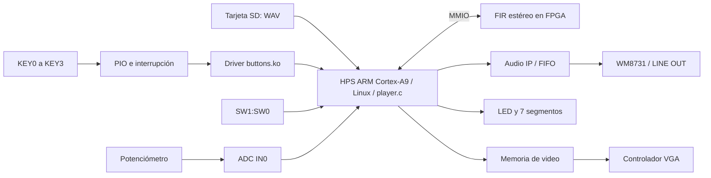

# Proyecto 2 - Reproductor de audio en DE1-SoC

**CE-1113 Sistemas Empotrados — II semestre 2026**

Christian Navarro, Jorge Gutiérrez, Mauricio Luna, Mauro Navarro.

El proyecto consiste en un reproductor WAV en la DE1-SoC. El HPS ejecuta Linux y se encarga de los archivos de la SD y del control del reproductor. La FPGA contiene los periféricos de audio, video, botones, ADC, displays y un filtro FIR estéreo desarrollado en SystemVerilog.

## Arquitectura



El audio se lee por muestras, se remuestrea a 44.1 kHz, se aplica el filtro seleccionado y se escala el volumen. El filtro FIR recibe y devuelve las dos muestras de un frame por registros Avalon MMIO. Los otros filtros se ejecutan en C. La FPGA genera las señales físicas de audio y video.

## Entorno de desarrollo

- Ubuntu 24.04, Quartus Prime Lite 25.1std con soporte Cyclone V y los IP del University Program.
- GCC cruzado `arm-linux-gnueabihf-gcc`, Make, Python 3 e Icarus Verilog.
- DE1-SoC con Linux Poky 8.0, kernel `3.12.0-00307-g507abb4-dirty`.
- Para el módulo del kernel se usó el árbol de Linux de la misma versión y GCC ARM 4.9.4.

En Ubuntu:

```sh
sudo apt install make gcc-arm-linux-gnueabihf iverilog python3 ffmpeg picocom openssh-client
export QUARTUS_ROOTDIR="$HOME/altera_lite/25.1std/quartus"
export PATH="$QUARTUS_ROOTDIR/bin:$QUARTUS_ROOTDIR/sopc_builder/bin:$PATH"
```

## Compilación

Desde la raíz del repositorio:

```sh
cd hw
make all
make power
cd ../sw
arm-linux-gnueabihf-gcc -Wall -O2 -static player.c -o player_v4 -lm
```

`make all` crea los sistemas de Platform Designer con Tcl, genera HDL, compila el SoC y crea los archivos `.sof`, `.rbf` y el encabezado de direcciones. Los reportes se encuentran en `hw/build/`. El RBF de la compilación se llama `DE1_SoC_Reproductor.rbf`.

Para reconstruir `buttons.ko`, se necesita el kernel del HPS, commit `507abb469931ebf60cc12b48dbd13611c11d2af3`, con su configuración original (obtenida de `/proc/config.gz`). En Ubuntu, con el GCC antiguo instalado:

```sh
export ARCH=arm
export CROSS_COMPILE="$HOME/empotrados/kernel-de1/gcc-4.9.4-nolibc/arm-linux-gnueabi/bin/arm-linux-gnueabi-"
export LOCALVERSION=-00307-g507abb4-dirty
cd ~/empotrados/kernel-de1/linux-socfpga-507abb469931ebf60cc12b48dbd13611c11d2af3
# Con la .config de la placa y CONFIG_LOCALVERSION_AUTO deshabilitado:
make olddefconfig
make -j2 HOSTCFLAGS="-O2 -Wall -fcommon" modules_prepare
```

Si el GCC antiguo necesita bibliotecas de compatibilidad, agregar su ubicación a `LD_LIBRARY_PATH`. Desde `sw/drivers` ejecutar `make clean` y `make`. Ajustar `KDIR` en el Makefile si el árbol del kernel está en otra ruta. Verificar el vermagic de `buttons.ko` contra `uname -r` antes de copiarlo a la placa.

## Instalación y arranque

La SD debe tener Linux compatible y los siguientes archivos en `/home/root/`:

- `DE1_SoC_Reproductor.rbf`, `buttons.ko`, `player_v4`.
- `canciones/` con al menos diez archivos WAV PCM 16 bits, mono o estéreo, de 8, 16 o 44.1 kHz.

Los archivos musicales comerciales no se incluyen en el repositorio. Se pueden preparar archivos propios o autorizados con FFmpeg, por ejemplo:

```sh
ffmpeg -i entrada.mp3 -c:a pcm_s16le -ar 16000 -ac 2 \
  -metadata title="Cancion de prueba" -metadata artist="Grupo Proyecto 2" \
  -metadata album="Pruebas" pista01.wav
```

Copiar los binarios, WAV y `sw/scripts/reproductor` a la placa mediante SCP desde Ubuntu. Usar `scp -O` para compatibilidad con el SSH antiguo y la IP actual del HPS. El procedimiento de inicio está en [sw/scripts/README.md](sw/scripts/README.md). No reprogramar la FPGA mientras el reproductor o el driver de botones estén utilizando sus registros.

## Uso

Conectar parlantes amplificados o audífonos a LINE OUT, el potenciómetro y el monitor VGA (640x480). Al encender la placa preparada, el reproductor inicia automáticamente. El tiempo de arranque observado fue aproximadamente 8 segundos con ADC y VGA habilitados.

| Botón | Función |
|---|---|
| KEY0 | Play / pausa; también reanuda desde stop |
| KEY1 | Stop |
| KEY2 | Pista anterior |
| KEY3 | Pista siguiente |

| SW1:SW0 | Filtro |
|---|---|
| 00 | Bypass |
| 01 | Pasa-bajos FIR en hardware |
| 10 | Pasa-altos en software |
| 11 | Eco en software |

Potenciómetro B10K lineal: extremos a 3.3 V y GND del GPIO, cursor a ADC_IN0. En la revisión F probada, GPIO0 pin 29 = 3.3 V, pin 30 = GND y J15 pin 2 = ADC_IN0. Verificar numeración y tensión antes de conectar, con la placa apagada durante el cableado. El volumen conserva el límite de software de 30% a escala completa del ADC (aproximadamente 24% máximo teórico con 3.3 V).

## Mapa de memoria (direcciones físicas del HPS)

| Periférico | Dirección |
|---|---|
| LEDs | 0xFF200000 |
| Tiempo BCD | 0xFF200020 |
| Switches | 0xFF200040 |
| Botones | 0xFF200050 |
| Timer | 0xFF202000 |
| Configuración audio/video | 0xFF203000 |
| Audio FIFO | 0xFF203040 |
| ADC | 0xFF204000 |
| FIR | 0xFF205000 |
| Memoria de píxeles | 0xC8000000 |
| Memoria de caracteres | 0xC9000000 |

### Registros FIR

| Offset desde 0xFF205000 | Registro | Función |
|---|---|---|
| 0x00 | CONTROL | Escribir 1 en bit 0 para reset |
| 0x04 | STATUS | bit 0 listo, bit 1 salida válida |
| 0x08 | DATA_IN | Escritura de muestras |
| 0x0C | DATA_OUT | Lectura de muestras filtradas |

En los registros de datos, los bits 15:0 son el canal izquierdo y 31:16 el derecho. Cada núcleo usa 31 coeficientes Q1.15 y un MAC secuencial. El acumulador es de 40 bits. La salida se satura a 16 bits.

## Pruebas y resultados

Desde la raíz del repositorio:

```sh
bash hw/sim/run_fir.sh
iverilog -g2012 -s tb_fir_mmio -o /tmp/tb_fir_mmio \
    hw/ip/audio_dsp/fir_core.sv hw/ip/audio_dsp/fir_mmio.sv hw/sim/tb_fir_mmio.sv
vvp /tmp/tb_fir_mmio
```

La simulación independiente del FIR pasó 525 muestras de prueba; las ganancias observadas a 1 kHz y 12 kHz fueron aproximadamente 0.9723 y 0.0009. También se verificó la interfaz MMIO estéreo en simulación y en placa mediante `sw/tests/test_fir.c`.

| Resultado | Valor observado |
|---|---|
| Lógica SoC | 4756 ALMs (15%) |
| FIR estéreo | 386.4 ALMs, 1326 registros, 2 DSP |
| Potencia estimada SoC | 911.94 mW (confianza baja) |
| Latencia interna máxima de botón | 1.526 ms |
| Latencia interna máxima de filtro | 0.034 ms |
| Latencia interna máxima de cambio de pista | 1.786 ms |
| Arranque final | aproximadamente 8 s |

El sistema reproduce canciones reales y se comprobó el control de volumen y la actualización de metadatos mediante lectura de la memoria VGA. Para repetir esa lectura, compilar `sw/tests/leer_vga.c` y ejecutar `./leer_vga` en la placa con la FPGA configurada y el reproductor activo. Es una prueba de memoria, no de salida de video física.

Los tiempos de latencia se midieron dentro del programa usando pistas de prueba; no incluyen todo el recorrido físico hasta la salida analógica. La validación visual del monitor, las latencias extremo a extremo y la prueba prolongada están pendientes. Se corrigió la restricción del reloj VGA y el análisis de setup y hold obtuvo slack positivo en los cuatro modelos temporales.

## Documentación

- [Diseño del sistema](docs/diseno_sistema.md)
- [Recursos, potencia y temporización](docs/recursos_y_potencia.md)
- [Mediciones de latencia](docs/latencias.md) y [logs originales](docs/evidencias/)
- [Arranque automático](sw/scripts/README.md)
- [Reproductor V4](sw/README_v4.md)

Las capturas de Quartus, las fotografías de montaje y el video de demostración se deben adjuntar antes de la entrega. No se incluyen aquí evidencias visuales que aún no se han tomado.
