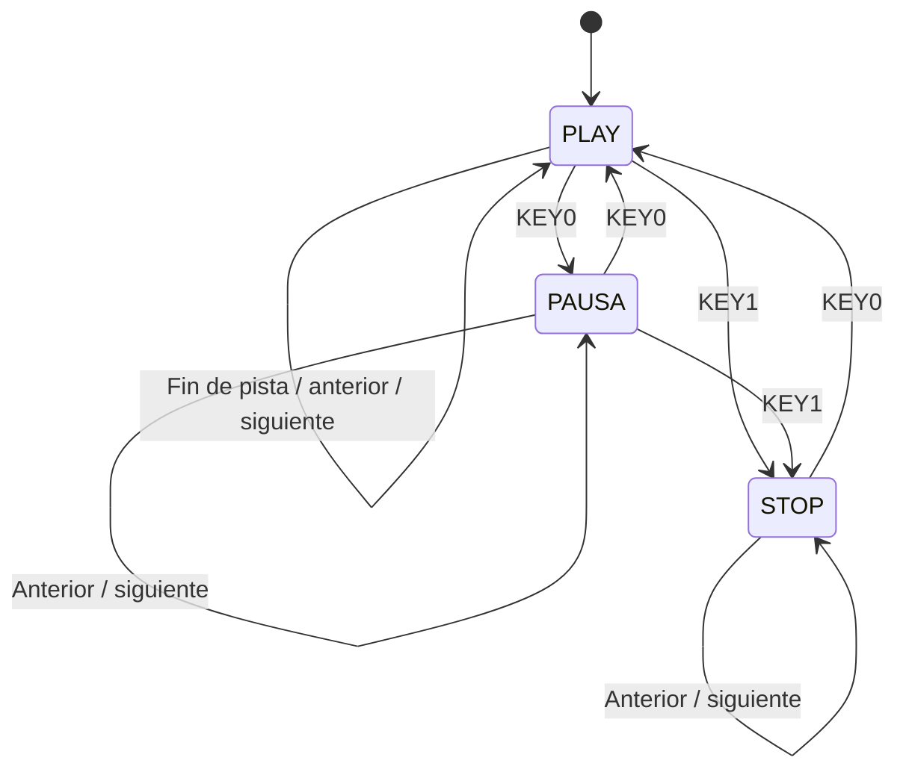
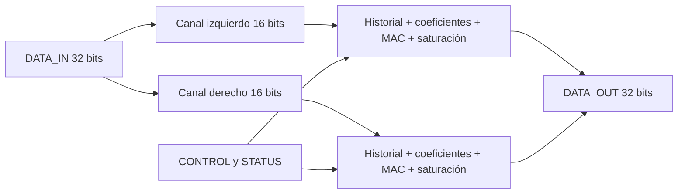

# Documento de diseño — Proyecto 2

CE-1113 Sistemas Empotrados, II semestre 2026

## 1. Problema y metodología

Se necesita un reproductor portable que funcione sin una computadora externa, lea diez canciones de la SD, maneje controles físicos y aplique filtros en tiempo real. Se dividió el problema en almacenamiento, control, procesamiento de audio y periféricos. Primero se desarrolló un SoC base, se probaron los periféricos, se diseñó y simuló el FIR de manera aislada y finalmente se integraron el módulo personalizado, el driver y el reproductor. Se hicieron pruebas sobre la placa y se optimizó el arranque.

### Alternativas consideradas

| Alternativa | Ventaja | Desventaja |
|---|---|---|
| Procesamiento de filtros en HPS | Fácil cambiar algoritmos en C | Carga de CPU y no satisface por sí solo el requisito de DSP HDL |
| Procesamiento de todos los filtros en FPGA | Paralelismo y control temporal | Mayor esfuerzo en HDL, recursos y verificación |
| HPS + FIR propio en FPGA (seleccionada) | Aprovecha Linux para SD y un DSP dedicado para el FIR | Requiere protocolo MMIO y espera de resultado |

Se eligió el HPS Cortex-A9 existente, sin añadir un procesador Nios V, para aprovechar el acceso a SD y el sistema Linux ya disponible. Los filtros pasa-altos y eco son simples de implementar en C. El FIR requiere varios productos y acumulaciones por muestra y se implementó en FPGA. No se midió una mejora de rendimiento frente a un FIR equivalente en C; la justificación se basa en la arquitectura y en el costo de hardware reportado.

## 2. Partición hardware/software

| Función | Implementación | Motivo |
|---|---|---|
| Lectura SD y metadatos | HPS | Sistema de archivos y lectura secuencial |
| Lista de reproducción y estados | HPS | Control sencillo de archivos y botones |
| Remuestreo, ganancia | HPS | Flexibilidad de frecuencias y volumen |
| Pasa-altos, eco | HPS | Algoritmos simples |
| FIR pasa-bajos | FPGA, HDL propio | MAC dedicado y punto fijo |
| Audio | FPGA, IP Audio | FIFO e interfaz física al WM8731 |
| Botones | PIO FPGA + driver HPS | Atención por interrupciones |
| ADC | IP FPGA + escala HPS | Conversión analógica y ajuste digital |
| VGA | Memorias, DMA y controlador FPGA + texto HPS | Separar datos de generación de señal |
| 7 segmentos | Decodificador HDL + BCD HPS | Evitar manejar segmentos desde C |

El temporizador y SysID forman parte del SoC base; SysID se usa para diagnóstico. El tiempo de reproducción se calcula con frames enviados, no con el timer. El timer quedó del diseño base y es una oportunidad de simplificación. Las direcciones físicas se documentan en el README.

## 3. Diseño de software

El programa `sw/player.c` se ejecuta como proceso de Linux. No necesita un escritorio ni una interfaz del sistema operativo para operar. Utiliza `stdio.h` para los WAV, `stdint.h` para representar muestras y registros, `fcntl.h`, `unistd.h` y `sys/mman.h` para acceder a dispositivos y memoria, `time.h` para tiempos, `signal.h` para finalizar y `errno.h` para errores de lectura.

| Método | Función |
|---|---|
| `read_wav`, `read_frame` | Validar RIFF/WAVE, leer fmt, data y LIST/INFO; extraer muestras |
| `rd`, `wr` | Leer y escribir registros MMIO con punteros volatile |
| `start_buttons`, `buttons` | Abrir /dev/fpga_buttons y leer eventos sin bloqueo, antirrebote de 150 ms |
| `reset_filter`, `apply_filter`, `esperar_fir` | Limpiar historial, procesar muestras y sincronizarse con FIR |
| `audio_space`, `send_frame` | Consultar espacio y enviar muestras a las FIFOs |
| `display_time`, `vga_line`, `show` | BCD, LEDs y metadatos en memoria de video |
| `play` | Ciclo de reproducción, control, remuestreo y volumen |
| `main` | Abrir archivos, cambiar de pista, mapear/desmapear memoria |

Los WAV deben ser PCM con 16 bits, mono o estéreo y frecuencia 8000, 16000 o 44100 Hz. Se usa interpolación lineal entre dos muestras y un acumulador de fase. En mono se duplica la muestra para los dos canales. La salida nominal es 44100 Hz. Los metadatos se leen de INAM, IART e IPRD y se calcula la duración con bytes de audio/(frecuencia * canales * 2). Las cadenas tienen capacidad de 79 caracteres más terminador; VGA muestra ASCII imprimible. Se leen frames progresivamente, sin almacenar la canción completa en RAM. El eco reserva 7200 pares de muestras de 16 bits y usa un retardo de 150 ms.



El driver `buttons.c` registra una IRQ del PIO (IRQ Linux 73 observada), limpia el registro edge capture y conserva una máscara de eventos. El proceso consulta `/dev/fpga_buttons` sin bloqueo; el ciclo revisa los eventos aproximadamente cada 5 ms y usa antirrebote. No se debe confundir esta consulta del dispositivo con sondeo directo de los pines: el evento lo captura la interrupción en el kernel. El estado y la pista se actualizan en `play` y `main`. Los switches se leen por MMIO y el ADC aproximadamente cada 50 ms. La máscara de los LEDs representa estado (bits bajos) y filtro (bits 4 y 5).

### Filtros software

Pasa-altos: se estima la componente lenta con `low += (x-low)/12`, luego se calcula `y=x-low`. Eco: `y=(2*x+old)/3`, donde `old` es la muestra almacenada 150 ms antes. Bypass no modifica las muestras antes de aplicar el volumen. La ganancia final es `volumen/100`. El ADC se lee a 12 bits; se conserva la escala de 0 a 30% del código. El potenciómetro B10K se alimenta con 3.3 V, por lo que no utiliza todo el rango de conversión de 4.096 V del ADC de la revisión probada. El enunciado menciona AD7928; la revisión F empleada se identificó con LTC2308 y se comprobó su acceso por el IP ADC Controller.

## 4. Diseño del hardware personalizado

El FIR pasa-bajos se diseñó con 31 coeficientes, frecuencia nominal 44.1 kHz y corte de diseño de 3 kHz. Los coeficientes se obtienen con sinc y ventana Hamming, se normalizan para ganancia DC unitaria y se cuantizan a Q1.15 con suma 32768. El archivo `.mem` se carga al sintetizar/simular. La salida se calcula como:

`y[n] = sum(h[k] * x[n-k]), k = 0..30`.

Para cada canal se desplaza el historial de 31 muestras de 16 bits, se selecciona un coeficiente y una muestra por ciclo, se multiplica (32 bits) y se acumula (40 bits). Al terminar se desplaza 15 bits a la derecha y se satura al rango -32768..32767.



Se usan dos instancias `fir_core` en `fir_mmio`. Cada una tiene estados IDLE, MAC, SCALE y OUTPUT. En IDLE se acepta la entrada, MAC ejecuta 31 multiplicaciones/acumulaciones consecutivas, SCALE genera la salida saturada y OUTPUT la mantiene hasta que se lea. El reloj es de 100 MHz. Desde el flanco que acepta la muestra hasta la salida válida transcurren 32 ciclos (31 MAC y uno SCALE), unos 320 ns ideales del núcleo, sin contar el acceso MMIO ni las esperas del HPS. El siguiente frame requiere consumir primero la salida.

Diagrama temporal simplificado (no es una captura de simulación):

```text
Ciclo (flanco)    0       1 ... 31      32       33
Estado después    MAC     MAC ... SCALE OUTPUT   IDLE*
DATA_IN write     ^
STATUS listo      1->0    0             0         1*
STATUS válido     0       0             1         0*
DATA_OUT read                                     ^*
* Si el HPS lee la salida en ese ciclo; si tarda, OUTPUT permanece válido.
```

La interfaz Avalon usa cuatro registros de 32 bits en 0xFF205000..0xFF20500F:

| Registro | Offset | Acceso | Descripción |
|---|---|---|---|
| CONTROL | 0 | W | bit 0 reinicia historial y estado |
| STATUS | 4 | R | bit 0 ambos canales listos, bit 1 ambos válidos |
| DATA_IN | 8 | W | PCM izquierdo bajo, derecho alto |
| DATA_OUT | 12 | R | PCM filtrado izquierdo bajo, derecho alto |

El HPS espera ready, escribe un frame, espera valid y lee. Se descarta una escritura fuera de ready. No hay una FIFO de frames dentro del FIR; el protocolo evita sobrescribir una salida no consumida. Un timeout provoca error y no cambia a un FIR de software.

## 5. Verificación e integración

Primero se simuló el núcleo FIR y se comparó con el resultado de referencia de punto fijo. El testbench pasó 525 muestras, con ganancias aproximadas de 0.9723 a 1 kHz y 0.0009 a 12 kHz. Se probó también el wrapper MMIO con reset, estado listo/ocupado, dato válido y canales independientes. Después se integró el IP en Platform Designer y se probó su interfaz desde C sobre la placa (impulso y reset). Las pruebas de software incluyeron los formatos WAV, controles físicos y cambio de filtros. Se verificaron diez canciones reales y se comprobó la lectura de caracteres de VGA después del arranque automático, con cambio de pista y volumen.

| Requisito | Estado observado |
|---|---|
| Diez WAV, SD, formatos 8/16/44.1 kHz | Probado |
| Metadatos, número y duración | Probado en memoria de caracteres |
| Controles y navegación continua | Probado funcionalmente |
| Driver IRQ y displays | Probado |
| FIR HDL, registros y verificación aislada | Probado |
| Tres filtros más bypass | Probado funcionalmente |
| Potenciómetro y ADC | Probado |
| Inicio inferior a 10 s | Aproximadamente 8 s, cronómetro |
| Latencias de botones, filtros y pistas | Favorables en pruebas internas; pendiente extremo a extremo |
| Salida VGA física | Pendiente de monitor |
| Estabilidad prolongada y calidad de audio | Prueba funcional realizada; falta ensayo prolongado y cuantitativo |
| Timing completo | No cerrado: violación clk_vga |

Los resultados de recursos, potencia y timing se incluyen en [recursos_y_potencia.md](recursos_y_potencia.md). Los resultados de latencia y sus limitaciones están en [latencias.md](latencias.md).

## 6. Herramientas y evidencias

- Quartus Prime Lite y Platform Designer: generación con Tcl, síntesis, Fitter, conversión SOF/RBF y mapa de periféricos. TimeQuest/Timing Analyzer y PowerPlay para análisis.
- SystemVerilog, Icarus Verilog y testbenches: núcleo FIR y MMIO. Python (`tools/generate_fir.py`) para coeficientes de punto fijo.
- GCC ARM y Make: compilación del reproductor y módulo del kernel. C, Linux y mmap para interfaz de bajo nivel.
- FFmpeg: conversión de canciones a PCM y etiquetas RIFF; Picocom y SSH/SCP para configuración y pruebas de la placa.
- Git/GitHub: ramas main, develop y feat/*, commits descriptivos y pull requests para integrar funcionalidades. Revisar y cerrar issues según las pruebas realizadas, sin marcar como resueltas las validaciones pendientes.

## 7. Cierre y demostración

Para la demostración conectar audio y VGA, encender, comprobar el tiempo de arranque, cambiar pistas, pausar, detener, reanudar, cambiar los cuatro modos de filtro, girar el potenciómetro y observar los indicadores. Tomar fotos y video reales de estas pruebas. La comprobación de memoria de video no reemplaza la prueba de monitor. Para medir latencia completa se puede registrar simultáneamente la acción física y el cambio visible o audible mediante instrumentos adecuados. Registrar los resultados sin estimar valores que no se hayan medido.

La configuración estable se conserva en la SD y el script de arranque en el repositorio. Antes de entregar se recomienda respaldar la SD final y comprobar el archivo comprimido y su hash. Los archivos de audio comerciales no deben subirse al repositorio.
